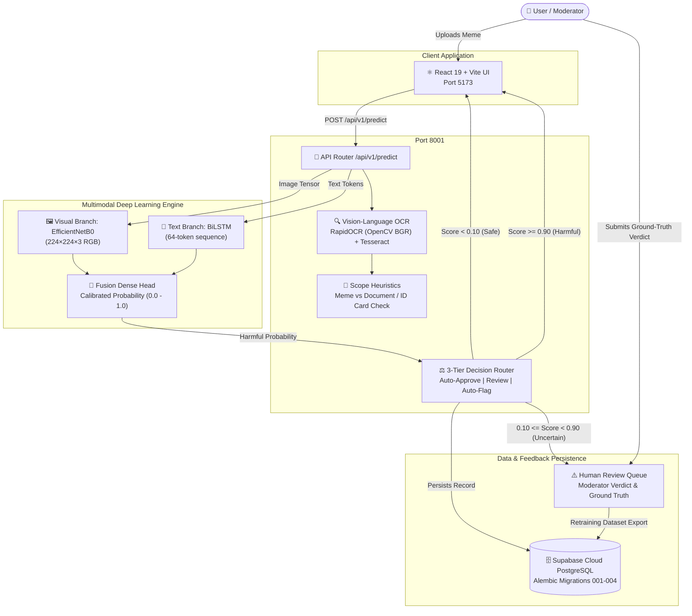

<div align="center">
  
  
  
  
  

  <h1>🛡️ MemeGuard — Multimodal Harmful Meme Detection System</h1>
  <p><i>An end-to-end, multimodal deep learning and automated content moderation system engineered to detect and flag offensive, harmful, and misogynistic memes using visual and textual fusion.</i></p>

  <p>
    <b>Department of Computer Engineering</b><br/>
    <b>M. H. Saboo Siddik College of Engineering, University of Mumbai</b><br/>
    <i>Academic Year 2026–2027</i>
  </p>
</div>

---

## 👥 Project Team & Mentorship

* **Project Mentor / Guide:** Prof. Er. Anand M. Bali
* **Head of Department:** Dr. Ashfaq Shaikh
* **Principal:** Dr. Mohammed Shafi Pathan

| Roll No. | Team Member | Primary Engineering Domain |
| :--- | :--- | :--- |
| **231202** | **Faisal Alvi** | Backend API Gateway, Moderation Router & Telemetry |
| **231232** | **Mohammed Aadil Kumshi** | Vision-Language OCR Pipeline & Scope Heuristics |
| **231238** | **Moinuddin Zaid Dhorajiwala** | Multimodal Deep Learning (EfficientNetB0 + BiLSTM) |
| **231239** | **Rohit Madhukar More** | Full-Stack UI, Supabase DB & Human-in-the-Loop Feedback |

> 📖 **Comprehensive Project Defense & Work Distribution:**  
> Detailed per-member contributions, viva questions, and technical answers can be found in [`docs/PROJECT_DEFENSE_AND_WORK_DISTRIBUTION.md`](docs/PROJECT_DEFENSE_AND_WORK_DISTRIBUTION.md).

---

## 🏗️ System Architecture & Workflow

Memes derive their meaning from the **joint semantic interaction** of text and imagery. An image alone or text alone may appear harmless, but together convey toxic or derogatory messages. MemeGuard resolves this with a dual-branch fusion model:



---

## 🌟 Key Features

1. **Multimodal Neural Fusion**: Combines **EfficientNetB0** (visual feature extractor, ~5.3M parameters) and **Bidirectional LSTM** (textual contextual encoder) with dense concatenation and sigmoid activation.
2. **Dual-Strategy OCR Engine**: Uses **RapidOCR** with OpenCV BGR angle and orientation detection for distorted meme text, with path-resilient **Tesseract OCR** fallback.
3. **Scope & Non-Meme Validation**: Distinguishes genuine memes from arbitrary documents, screenshots, and university ID cards to prevent false-alarm classifications.
4. **3-Tier Intelligent Moderation Router**:
   * **`AUTO_APPROVE`** ($P < 0.10$): Clear safe content passed automatically.
   * **`HUMAN_REVIEW`** ($0.10 \le P < 0.90$): Ambiguous or borderline memes routed to the human moderation queue.
   * **`AUTO_FLAG`** ($P \ge 0.90$): Highly confident harmful content immediately quarantined.
5. **Human-in-the-Loop Feedback Loop**: Real-time moderation interface to record human ground-truth labels (`Mark Safe`, `Mark Harmful`, `Mark Not a Meme`) for continuous active learning.
6. **Cloud Database with Connection Pooling**: Powered by **Supabase PostgreSQL** via SQLAlchemy 2.0 with pre-ping validation, thread-safe session factories, and Alembic versioning.

---

## 📁 Repository Structure

```text
meme-detection/
├── 📂 backend/
│   ├── 📂 api/                # FastAPI routers (predict, detect, review)
│   ├── 📂 core/               # App configuration, database connection, logger
│   ├── 📂 migrations/         # Alembic database migrations (001 - 004)
│   ├── 📂 ml_assets/          # baseline_best_model.keras (Trained weights & vectorizer)
│   ├── 📂 models/             # SQLAlchemy ORM models (Prediction, ScanHistory, DurableImages)
│   ├── 📂 schemas/            # Pydantic schemas and API contracts
│   ├── 📂 services/           # Model inference, RapidOCR, decision router
│   ├── 📂 storage/            # Uploads and heatmap asset directories
│   ├── 📄 main.py             # FastAPI entrypoint and lifespan events
│   ├── 📄 requirements.txt    # Pinned Python dependencies
│   └── 📄 run.bat             # Dedicated backend runner
├── 📂 frontend/
│   ├── 📂 src/
│   │   ├── 📂 components/     # ResultsCard, ReviewQueueTable, ConfidenceMeter
│   │   ├── 📂 pages/          # Dashboard and Moderator Review Queue
│   │   └── 📂 services/       # API client configuration
│   ├── 📄 package.json        # Frontend dependencies (React 19, Vite, Tailwind)
│   └── 📄 vite.config.js      # Vite dev server configuration (Port 5173)
├── 📂 docs/
│   ├── 📄 PROJECT_DEFENSE_AND_WORK_DISTRIBUTION.md  # Viva defense guide & member roles
│   └── 📄 inference-diagnosis.md                    # Benchmark evaluation results
├── 📄 start_project.bat       # Single-click launcher for Backend & Frontend
└── 📄 README.md               # Project documentation
```

---

## 🚀 Quick Start Guide

### Option A: One-Click Launch (Windows)
Double-click [`start_project.bat`](start_project.bat) from the root folder. Both the backend and frontend development servers will launch automatically with full UTF-8 encoding support.

---

### Option B: Manual Terminal Execution

#### 1. Backend Setup (Port 8001)

```powershell
cd backend

# 1. Activate virtual environment
.\.venv\Scripts\activate

# 2. Install dependencies
pip install -r requirements.txt

# 3. Apply Supabase database migrations
alembic upgrade head

# 4. Start the FastAPI server on port 8001
python -m uvicorn app.main:app --reload --port 8001
```
* Interactive API Documentation (Swagger): [http://localhost:8001/docs](http://localhost:8001/docs)
* Health Check Endpoint: [http://localhost:8001/health](http://localhost:8001/health)

#### 2. Frontend Setup (Port 5173)

```powershell
cd frontend

# 1. Install dependencies
npm install

# 2. Start the Vite development server
npm run dev
```
* Web Application Interface: [http://localhost:5173](http://localhost:5173)
* Moderator Queue Interface: [http://localhost:5173/moderator](http://localhost:5173/moderator)

---

## 🧪 Testing & Verification

```powershell
# Run backend unit and integration test suite
cd backend
pytest -v

# Run frontend production build validation
cd ../frontend
npm run build
```

---

<div align="center">
  <i>Developed for academic excellence in intelligent multimodal content moderation.</i>
</div>
